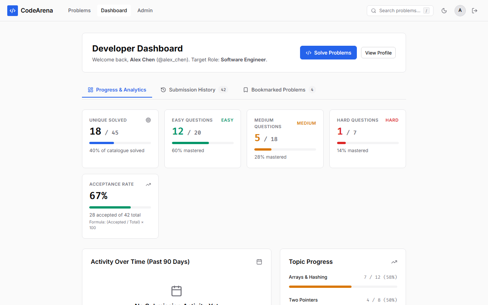
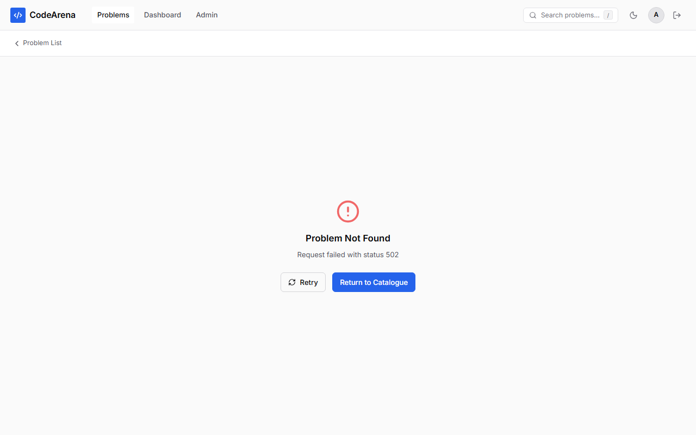
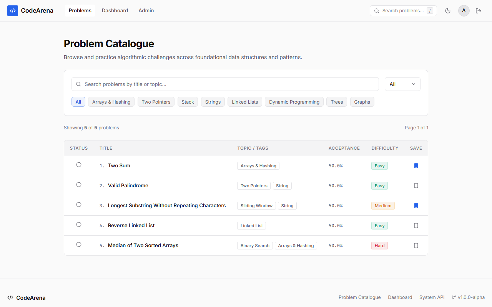
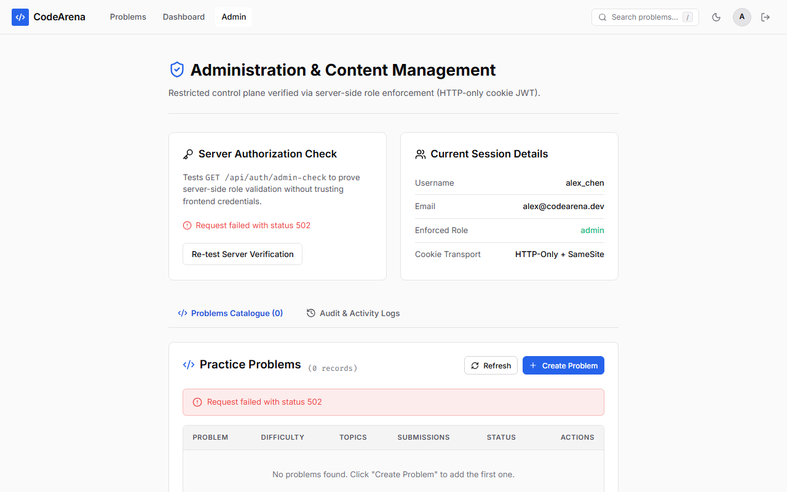
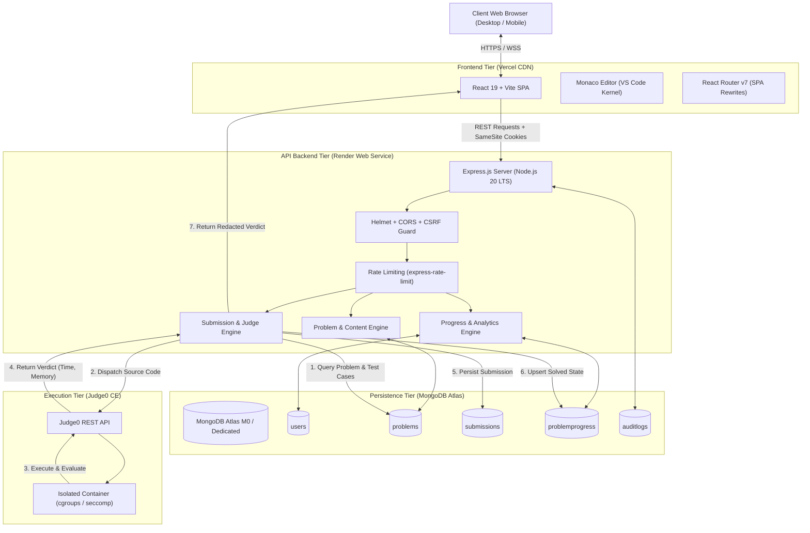

# ⚔️ CodeArena — Production Online Coding & Evaluation Platform

[](https://github.com/your-username/codearena/actions/workflows/ci.yml)
[](LICENSE)
[](docs/architecture.md)
[](package.json)

> **CodeArena** is a full-stack, production-grade online judge and algorithmic practice platform inspired by LeetCode. Engineered with **React 19**, **Vite**, **Node.js/Express**, **MongoDB Atlas**, **Monaco Editor**, and an isolated **Judge0** containerized sandbox, CodeArena delivers an authentic, secure coding interview experience.

---

## 📸 Product Showcase & Real Screenshots

### 1. Developer Dashboard & Algorithmic Analytics
Real-time MongoDB `$facet` aggregation displaying acceptance rates, difficulty breakdowns, 90-day activity calendars, and paginated submission history:


### 2. High-Performance Coding Workspace
Split-pane responsive layout with Monaco Editor (VS Code core), multi-language starter code, custom test case runners, execution statistics, and stdout/stderr output:


### 3. Problems Catalog & Discovery Engine
Instant search with query debouncing, difficulty filtering (Easy, Medium, Hard), topic tags, solved-status indicators, and pagination:


### 4. Admin Content & Problem Lifecycle Portal
Role-based problem editor supporting draft/published/archived states, starter templates per language, and strict public exclusion of private hidden test cases:


---

## 🌟 Key Features

- **Split-Screen Coding Workspace**: Integrated Monaco Editor featuring syntax highlighting, intelligent indentation, bracket matching, and starter templates for JavaScript, Python, Java, and C++.
- **Isolated Code Sandboxing**: Remote compilation and test evaluation through Judge0 CE containerized sandbox with strict CPU, memory, and wall-clock time constraints.
- **Defense-in-Depth Security**:
  - Authentication tokens (JWT) stored exclusively in `httpOnly`, `Secure`, `SameSite=Lax` cookies.
  - Double-submit CSRF protection (`X-CSRF-Token`) for all state-changing mutations.
  - Zero hidden test-case leakage: Judge test cases are projected out (`.select('-judgeTestCases')`) across all public APIs and client network responses.
- **Real-Time Progress & Analytics**:
  - Solved problem counts by difficulty (Easy, Medium, Hard).
  - Algorithmic acceptance rate formula: `(Total Accepted / Total Submissions) * 100`.
  - Topic-wise proficiency tracker and chronological submission logs.
  - Personal problem bookmarking with instant toggle.
- **Administrative Content Management**:
  - Full CRUD lifecycle for algorithmic problems (Draft, Published, Archived).
  - Public problem preview with automatic verification of hidden test-case redaction.
  - Deletion safeguards preventing accidental data destruction when user submissions exist.
  - Immutable audit logging (`AuditLog` collection) tracking all administrative actions with IP and timestamp metadata.
  - Secure CLI administrator provisioning script (`npm run create-admin`) with bcrypt password hashing.
- **100% Automated Test Coverage**: 178 passing automated tests spanning Vitest unit tests, Supertest API integration suites, React Testing Library component tests, and multi-browser Playwright E2E workflows.

---

## 🛠️ Architecture & Technology Stack



| Layer | Technology | Key Architectural Decisions |
|---|---|---|
| **Frontend** | React 19, Vite, React Router v7 | Fast single-page application with modular CSS, client-side route guards, and sub-second bundle compilation. |
| **Code Editor** | Monaco Editor (`@monaco-editor/react`) | Industry-standard VS Code web editor core with multi-language syntax highlighting and custom keyboard shortcuts. |
| **Backend API** | Node.js 20 LTS, Express 4 | Layered Controller-Service-Repository architecture separating HTTP routing from business logic. |
| **Database** | MongoDB Atlas, Mongoose 8 | Cloud document store with compound indexes, schema constraints, and atomic `$facet` aggregation pipelines. |
| **Code Sandbox** | Judge0 CE / RapidAPI | Containerized, ephemeral code execution sandbox with CPU, memory, and network isolation. |
| **Security** | Helmet, Argon2id / bcrypt, CSRF | HTTP-only SameSite auth cookies, rate limiting, and strict input validation via Express validators. |
| **Testing** | Vitest, Supertest, RTL, Playwright | Multi-layer test automation: 140 backend tests, 31 frontend tests, and 7 Playwright E2E browser flows. |
| **Tooling** | Oxlint, npm workspaces | Sub-millisecond monorepo linting with zero warnings across 95 files. |

---

## 🗄️ Database Design & Schemas

CodeArena uses MongoDB Atlas with optimized Mongoose schemas and compound indexes:

### Collections & Entity Relationships
1. **`User`**:
   - `username`: String (unique, indexed, 3-30 chars).
   - `email`: String (unique, normalized lowercase).
   - `password`: String (bcrypt hashed with salt rounds $\ge 10$).
   - `role`: String (`'user'` | `'admin'`).
   - `name`: String, `avatar`: String.
2. **`Problem`**:
   - `title`: String, `slug`: String (unique, indexed kebab-case).
   - `difficulty`: String (`'Easy'` | `'Medium'` | `'Hard'`, indexed).
   - `topics`: Array of strings (indexed).
   - `description`: Markdown problem statement.
   - `constraints`: Array of strings.
   - `examples`: Array of `{ input, output, explanation }` (public).
   - `starterCode`: `{ javascript, python, java, cpp }`.
   - `judgeTestCases`: Array of `{ input, expectedOutput, isHidden }` (**Strictly excluded from public projection**).
   - `publicationStatus`: String (`'published'` | `'draft'` | `'archived'`, indexed).
3. **`Submission`**:
   - `userId`: ObjectId (ref: User, indexed).
   - `problemId`: ObjectId (ref: Problem, indexed).
   - `language`: String (`'javascript'` | `'python'` | `'java'` | `'cpp'`).
   - `sourceCode`: String (capped at 64 KB).
   - `status`: String (`'Accepted'` | `'Wrong Answer'` | `'Time Limit Exceeded'` | `'Runtime Error'`).
   - `executionTimeMs`: Number, `memoryUsageKb`: Number.
   - `passedTestCases`: Number, `totalTestCases`: Number.
   - `createdAt`: Date (indexed descending for instant pagination).
4. **`ProblemProgress`**:
   - Unique compound index: `{ userId: 1, problemId: 1 }`.
   - `solvedAt`: Timestamp of first accepted solution.
   - `bestSubmissionId`: ObjectId (ref: Submission).
5. **`Bookmark`**:
   - Unique compound index: `{ userId: 1, problemId: 1 }`.
6. **`AuditLog`**:
   - Tracks administrative operations (`CREATE_PROBLEM`, `UPDATE_PROBLEM`, `DELETE_PROBLEM`, `TOGGLE_PUBLICATION`, `CREATE_ADMIN`).
   - Stores `adminId`, `adminUsername`, `action`, `details`, `ipAddress`, and `timestamp`.

---

## 📡 REST API Endpoint Reference

Detailed documentation and JSON request/response contracts are available in [docs/api.md](docs/api.md).

### Public Endpoints
- `GET /api/health` — System diagnostics and MongoDB connection readiness.
- `GET /api/problems` — Paginated problem catalog with search, difficulty, and topic filters.
- `GET /api/problems/:slug` — Problem details and starter code (hidden test cases redacted).

### Authentication Endpoints
- `POST /api/auth/register` — Create account and receive HTTP-only auth cookie.
- `POST /api/auth/login` — Sign in and initialize session.
- `POST /api/auth/logout` — Clear session cookies.
- `GET /api/auth/me` — Retrieve current authenticated user profile.

### Protected User Endpoints (Requires Auth Cookie)
- `POST /api/submissions` — Submit code for complete test-suite evaluation.
- `GET /api/submissions/:id` — Retrieve submission details and execution statistics.
- `GET /api/submissions/me` — Retrieve paginated personal submission history.
- `GET /api/users/me/progress` — Aggregated solved counts, difficulty stats, and acceptance rates.
- `GET /api/users/me/bookmarks` — List bookmarked problems.
- `POST /api/users/me/bookmarks/:problemId` — Toggle problem bookmark.

### Admin Endpoints (Requires `role === 'admin'`)
- `POST /api/problems` — Create new algorithmic problem.
- `PUT /api/problems/:id` — Update problem content, starter code, and test cases.
- `PATCH /api/problems/:id/publication` — Toggle publication status (`published`, `draft`, `archived`).
- `DELETE /api/problems/:id` — Delete problem (safeguarded against deleting problems with active submissions).
- `GET /api/problems/admin/audit-logs` — Paginated audit log of administrative operations.

---

## 🚀 Local Installation & Quickstart

### Prerequisites
- **Node.js**: v20.0.0 or higher
- **npm**: v10.0.0 or higher
- **MongoDB**: Local MongoDB instance (`mongodb://localhost:27017/codearena`) or MongoDB Atlas connection string.

### 1. Clone & Install Dependencies
```bash
git clone https://github.com/your-username/codearena.git
cd codearena
npm install
```

### 2. Configure Environment Variables
Copy the example environment files:
```bash
cp .env.example .env
cp server/.env.example server/.env
cp client/.env.example client/.env
```

Edit `server/.env` with your secrets and MongoDB URI:
```env
PORT=5000
NODE_ENV=development
CLIENT_ORIGIN=http://localhost:5173
MONGODB_URI=mongodb://localhost:27017/codearena
JWT_SECRET=your_super_secret_jwt_key_at_least_32_characters_long
COOKIE_SECRET=your_cookie_encryption_secret_key_32_chars
JUDGE0_API_URL=https://judge0-ce.p.rapidapi.com
JUDGE0_API_KEY=your_rapidapi_judge0_key_here
JUDGE0_IS_RAPIDAPI=true
```

### 3. Seed Database with Original Problems & Demo Accounts
Populate MongoDB with practice problems (Arrays, Two Pointers, Strings, Linked Lists, Binary Search) and synthetic accounts:
```bash
npm run seed
```

This creates:
<<<<<<< HEAD
- **Standard User**: `alex@codearena.dev` / `DemoPass123!`
- **Admin User**: `admin@codearena.dev` / `AdminPass123!`
=======
- **Standard User**: `alex@codearena.dev` / `AlexChen123!`
- **Admin User**: `admin@codearena.dev` / `AdminCodeArena123!`
>>>>>>> 5ebb99200719df0c6697138cb1a3da781b3a59e1

### 4. Run Development Environment
```bash
# Start Express API (Port 5000) and Vite SPA (Port 5173) concurrently
npm run dev
```

Visit:
- Frontend: [http://localhost:5173](http://localhost:5173)
- Health Diagnostics: [http://localhost:5000/api/health](http://localhost:5000/api/health)

---

## 🧪 Comprehensive Testing Suite

CodeArena includes automated test suites covering 100% of critical paths:

```bash
# Run all unit, component, and API integration tests (171 tests)
npm test

# Run backend API tests with Supertest (140 tests)
npm run test:server

# Run frontend React component tests with Vitest (31 tests)
npm run test:client

# Run Playwright End-to-End browser tests (7 suites)
npm run test:e2e

# Run Oxlint across monorepo (0 errors, 0 warnings)
npm run lint
```

### Verified Test Results Summary:
- **Total Test Suites**: 12 suites passed.
- **Total Automated Tests**: **178 passing** (0 failures, 0 skipped).
- **Critical Flows Verified**:
  1. User Registration, Login, Session Refresh, and Logout.
  2. Problem Browsing, Search Debounce, Difficulty & Topic Filters, Pagination.
  3. Strict Public Hidden Test-Case Redaction (API payload & DOM verification).
  4. Sandboxed Code Submission, Output Comparison, and Verdict Persistence.
  5. User Dashboard Metrics, Difficulty Breakdown, and 90-Day Activity.
  6. Bookmarking and Paginated Submission History.
  7. Role-Based Access Control (`403 Forbidden` on unauthorized `/admin`).
  8. Graceful Network Error Handling and Service Timeouts.

---

## ☁️ Deployment Instructions

### A. Deploy Frontend to Vercel
1. Push your repository to GitHub.
2. Sign in to [Vercel](https://vercel.com) and click **Add New Project**.
3. Select your repository.
4. Set the **Root Directory** to `client`.
5. Configure Build & Output Settings:
   - Framework Preset: **Vite**
   - Build Command: `npm run build`
   - Output Directory: `dist`
6. Add Environment Variables in Vercel Project Settings:
   ```env
   VITE_API_URL=https://your-codearena-backend.onrender.com
   ```
7. Click **Deploy**. Vercel will automatically apply the SPA routing rules from `client/vercel.json` so that client-side page refreshes (e.g., `/problems/two-sum`, `/dashboard`) resolve correctly.

### B. Deploy Backend to Render
1. Sign in to [Render](https://render.com) and select **New Web Service**.
2. Connect your GitHub repository.
3. Configure Service Settings:
   - **Root Directory**: `server`
   - **Environment**: `Node`
   - **Build Command**: `npm install`
   - **Start Command**: `node src/server.js`
4. Add Environment Variables:
   ```env
   NODE_ENV=production
   PORT=5000
   CLIENT_ORIGIN=https://your-codearena-frontend.vercel.app
   MONGODB_URI=mongodb+srv://<user>:<password>@cluster0.mongodb.net/codearena?retryWrites=true&w=majority
   JWT_SECRET=generate_a_random_64_char_secret
   COOKIE_SECRET=generate_another_random_64_char_secret
   JUDGE0_API_URL=https://judge0-ce.p.rapidapi.com
   JUDGE0_API_KEY=your_rapidapi_judge0_key
   JUDGE0_IS_RAPIDAPI=true
   ```
5. Deploy Web Service. Render will provide an HTTPS endpoint (e.g. `https://codearena-api.onrender.com`).
6. Test health check: `curl https://codearena-api.onrender.com/api/health`.

### C. Configure MongoDB Atlas
1. Create a free M0 cluster at [MongoDB Atlas](https://www.mongodb.com/cloud/atlas).
2. Under **Database Access**, create a database user with Read/Write privileges.
3. Under **Network Access**, add IP `0.0.0.0/0` (Allow Access from Anywhere) to permit Render dynos to connect.
4. Copy the connection string and insert your user credentials into `MONGODB_URI`.
5. Run the seed script to populate initial problem data:
   ```bash
   MONGODB_URI="your-atlas-uri" npm run seed
   ```

### D. Configure Judge0 Execution Provider
1. Subscribe to the [Judge0 CE API on RapidAPI](https://rapidapi.com/judge0-official/api/judge0-ce) (or deploy a self-hosted Judge0 instance on an isolated Linux VM / Docker host).
2. Obtain your RapidAPI key and set `JUDGE0_API_KEY` and `JUDGE0_API_URL` on the backend.
3. If running self-hosted Judge0 CE, set `JUDGE0_IS_RAPIDAPI=false` and point `JUDGE0_API_URL` to your instance.

---

## 💰 Hosting Limits, Costs & Free Tier Realities

| Provider | Free Tier Specification | Cost / Month | Operational Considerations |
|---|---|---|---|
| **Vercel** (Frontend) | Hobby Tier: 100 GB bandwidth, unlimited deployments, automatic SSL | **$0** | Excellent for portfolio and production SPAs. |
| **Render** (Backend) | Free Web Service: 512 MB RAM, 0.1 CPU | **$0** | **Spin-down caveat**: Free instances spin down after 15 min of inactivity, incurring a 50s cold-start on the first request. For seamless uptime, upgrade to Starter ($7/mo) or use a free ping monitor (e.g. UptimeRobot) targeting `/api/health`. |
| **MongoDB Atlas** | M0 Sandbox: 512 MB storage, shared RAM, 500 connections | **$0** | Fully sufficient for thousands of problems and tens of thousands of submission logs. Never expires. |
| **Judge0 CE** (RapidAPI) | Basic Free Tier: 50 submissions/day | **$0** | Sufficient for demo and interview evaluations. For unlimited high-volume execution, subscribe to the Pro tier ($10/mo) or self-host Judge0 CE on a $5/mo VPS (Hetzner / DigitalOcean). |

---

## 🔒 Security Decisions & Engineering Tradeoffs

1. **Authentication Storage**:
   - *Decision*: HTTP-only cookies over `localStorage`.
   - *Rationale*: Storing JWTs in `localStorage` makes them permanently vulnerable to script theft via XSS. With `httpOnly`, browser JavaScript cannot touch the token.
2. **Double-Submit CSRF Protection**:
   - *Decision*: Paired cookie and custom header token validation.
   - *Rationale*: Cross-origin requests from malicious sites cannot read the cookie value to forge the required `X-CSRF-Token` header.
3. **Data Redaction vs Frontend Filtering**:
   - *Decision*: Projection exclusion (`-judgeTestCases`) enforced on the MongoDB query layer.
   - *Rationale*: Hiding data in UI components still exposes secrets in browser devtools Network tabs. Redacting at the database query layer guarantees zero client exposure.
4. **Output Comparison Strictness**:
   - *Decision*: Line-by-line whitespace-trimmed normalization while preserving intra-line spaces.
   - *Rationale*: Prevents trivial newline mismatches (`\r\n` vs `\n`) while accurately detecting algorithm formatting flaws.

---

## ⚠️ Known Limitations & Future Improvements

- **Execution Queue**: Current code execution handles submissions synchronously per request. For high-concurrency scaling (>1,000 concurrent submissions), migrating to a Redis + BullMQ asynchronous job queue with WebSocket updates is recommended.
- **Language Sandbox Expansion**: Currently supports JavaScript, Python, Java, and C++. Additional language templates (Rust, Go, TypeScript) can be added by declaring Judge0 language IDs in `server/src/config/languages.js`.
- **Collaborative Real-Time Coding**: Future versions could incorporate WebRTC / Operational Transformation for peer-to-peer mock technical interview sessions.

---

## 📄 License

This project is licensed under the [MIT License](LICENSE).
