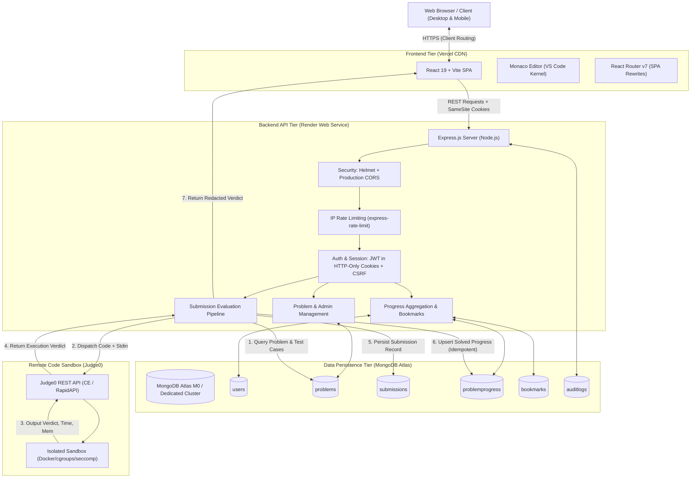
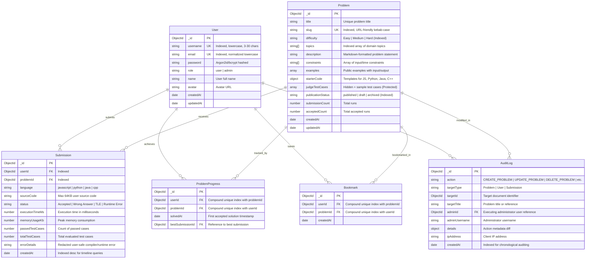
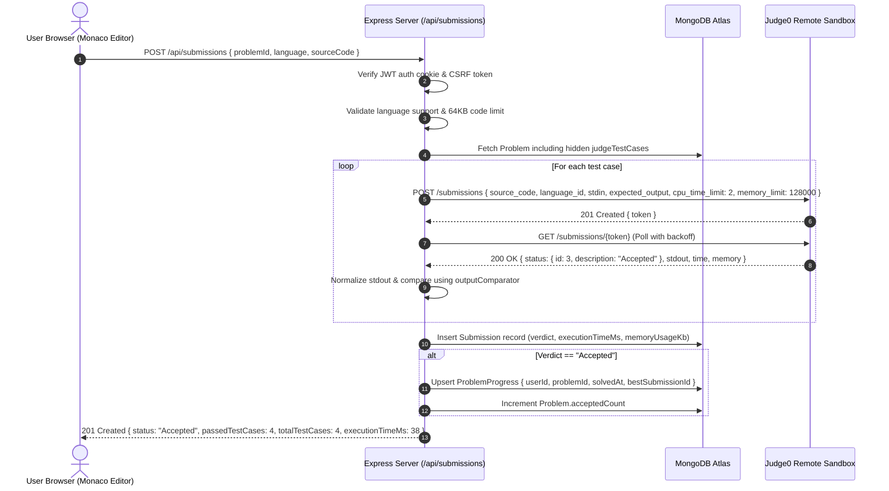

# CodeArena — System Architecture & Design Specification

CodeArena is a production-grade, highly scalable online coding practice and competitive programming platform inspired by LeetCode. Engineered for technical interview preparation, algorithmic problem solving, and full-stack software development excellence, CodeArena separates concerns between an optimized single-page frontend (React 19 + Vite), an enterprise-ready REST backend (Node.js + Express), a cloud document database (MongoDB Atlas), and an isolated, containerized code evaluation sandbox (Judge0).

---

## 1. High-Level System Architecture



---

## 2. Monorepo Organization & Directory Topology

CodeArena utilizes an **npm workspaces** monorepo pattern to share development toolchains, linting rules, and end-to-end tests while preserving strict physical boundaries between client and server code:

```
CodeArena/
├── .github/
│   └── workflows/
│       └── ci.yml               # Automated CI pipeline (lint, test, build, e2e)
├── client/                      # Frontend React 19 + Vite SPA
│   ├── public/                  # Favicons, robots.txt, static icons
│   ├── src/
│   │   ├── components/          # Reusable UI components
│   │   │   ├── common/          # Navbar, Footer, StatusBadge, Button, Toast
│   │   │   ├── home/            # Hero, HealthCard, FeatureGrid, ArchitectureSection
│   │   │   └── workspace/       # SplitPane, MonacoEditor, TestRunner, ConsoleOutput
│   │   ├── context/             # AuthContext, ThemeContext, ToastContext
│   │   ├── hooks/               # useDebounce, useHealthCheck, useAuth, useTheme
│   │   ├── pages/               # Route views (Home, Problems, Workspace, Dashboard, Admin)
│   │   ├── routes/              # AppRoutes.jsx (Public, Protected, AdminRoute)
│   │   ├── services/            # Axios API clients (auth, problems, submissions, user)
│   │   ├── styles/              # Global tokens, CSS variables, dark theme
│   │   ├── tests/               # Vitest + React Testing Library suites (31 tests)
│   │   ├── App.jsx              # Root layout & route wrapper
│   │   └── main.jsx             # React DOM root entry
│   ├── vercel.json              # Vercel SPA rewrites and security headers
│   ├── vite.config.js           # Vite dev proxy & build configuration
│   └── package.json             # Frontend dependencies
├── server/                      # Backend Node.js + Express REST API
│   ├── src/
│   │   ├── config/              # env.js, db.js (Mongoose pool & lifecycle)
│   │   ├── controllers/         # health, auth, problem, submission, user controllers
│   │   ├── middleware/          # auth, role, csrf, rateLimiter, errorHandler, logging
│   │   ├── models/              # User, Problem, Submission, ProblemProgress, Bookmark, AuditLog
│   │   ├── routes/              # health, auth, problem, submission, user routes
│   │   ├── scripts/             # seed.js (diverse problems), createAdmin.js (CLI provisioning)
│   │   ├── services/            # judge0.service, submission.service, problem.service, user.service
│   │   ├── utils/               # outputComparator (strict whitespace & trim), logger
│   │   ├── validators/          # problem.validator, submission.validator, user.validator
│   │   ├── app.js               # Express application instance & middleware assembly
│   │   └── server.js            # Node HTTP server bootstrap & graceful shutdown hooks
│   ├── tests/                   # 140 Vitest + Supertest integration & unit tests
│   └── package.json             # Backend dependencies
├── docs/                        # Engineering documentation & architecture specifications
│   ├── screenshots/             # Real UI screenshots (Home, Problems, Workspace, Dashboard, Admin)
│   ├── architecture.md          # System architecture & design specs (this file)
│   ├── api.md                   # Full REST API contracts and data schemas
│   └── judging-service.md       # Judge0 integration guide & execution protocol
├── e2e/                         # Playwright End-to-End browser tests (8 critical flows)
├── playwright.config.js         # Playwright multi-browser test harness
├── render.yaml                  # Render Infrastructure as Code service definition
├── vercel.json                  # Root fallback Vercel deployment configuration
├── LICENSE                      # MIT Open Source License
├── .env.example                 # Root environment variable documentation
├── package.json                 # Monorepo root workspace orchestrator
└── README.md                    # Project overview, launch documentation, and portfolio showcase
```

---

## 3. Backend Layered Architecture & Separation of Concerns

To ensure maintainability, testability, and resilience, the server strictly adheres to a **Controller-Service-Repository** layered architecture:

```
┌────────────────────────────────────────────────────────┐
│               Incoming HTTP/HTTPS Request              │
└───────────────────────────┬────────────────────────────┘
                            │
                            ▼
┌────────────────────────────────────────────────────────┐
│             Middleware Pipeline & Filters              │
│  - Helmet (HSTS, CSP, X-Frame-Options)                 │
│  - Production CORS (Whitelist client origin + cookies) │
│  - Rate Limiters (Global + strict Auth limits)         │
│  - Cookie Parser (Parse signed & raw cookies)          │
│  - Authentication Guard (verify JWT in auth cookie)    │
│  - CSRF Guard (Validate X-CSRF-Token vs csrfToken)     │
│  - Role Authorization (e.g., requireRole('admin'))     │
│  - Request Schema Validator (Joi / expressive rules)   │
└───────────────────────────┬────────────────────────────┘
                            │
                            ▼
┌────────────────────────────────────────────────────────┐
│               Routing Layer (src/routes/)              │
│  - Maps URI paths & HTTP methods to controller actions │
│  - Isolates feature domains (auth, problems, etc.)     │
└───────────────────────────┬────────────────────────────┘
                            │
                            ▼
┌────────────────────────────────────────────────────────┐
│             Controller Layer (src/controllers/)        │
│  - Extracts validated params, queries, and bodies      │
│  - Delegates business orchestration to Services        │
│  - Formats standard JSON success/error envelopes       │
│  - Never runs raw database queries or direct HTTP jobs │
└───────────────────────────┬────────────────────────────┘
                            │
                            ▼
┌────────────────────────────────────────────────────────┐
│               Service Layer (src/services/)            │
│  - Core algorithmic problem logic & permission rules   │
│  - Multi-collection atomic workflows & transactions    │
│  - Output comparison and normalization                 │
│  - Remote Judge0 API execution & polling               │
│  - User progress aggregation ($facet pipelines)        │
└───────────────────────────┬────────────────────────────┘
                            │
                            ▼
┌────────────────────────────────────────────────────────┐
│                 Data Access Layer (Mongoose)           │
│  - Schema definitions with strict type enforcement     │
│  - Compound indexes (e.g. { userId: 1, problemId: 1 }) │
│  - Pre-save password hashing hooks                     │
│  - MongoDB Atlas document persistence                  │
└────────────────────────────────────────────────────────┘
```

---

## 4. Database Design & Entity Relationship Model

The database is built on **MongoDB Atlas** using **Mongoose 8** schemas designed for fast lookups, compound index optimization, and relational referential integrity.



### Key Indexing Strategies
1. **User Lookups**: Unique indexes on `User.email` and `User.username`.
2. **Problems Filter & Search**: Compound index on `{ publicationStatus: 1, difficulty: 1 }` and `{ topics: 1 }` for instant catalog filtering. Text index on `{ title: 'text', description: 'text' }`.
3. **Submissions Timeline**: Compound index on `{ userId: 1, createdAt: -1 }` for instantaneous paginated submission history.
4. **Idempotent Solved State**: Unique compound index on `ProblemProgress`:
   ```javascript
   problemProgressSchema.index({ userId: 1, problemId: 1 }, { unique: true });
   ```
5. **Bookmark Uniqueness**: Unique compound index on `Bookmark`:
   ```javascript
   bookmarkSchema.index({ userId: 1, problemId: 1 }, { unique: true });
   ```

---

## 5. Security & Defense-in-Depth Architecture

CodeArena implements an industry-standard defense-in-depth model across transport, session, access control, and code isolation:

### A. Authentication & Session Management
- **HTTP-Only Cookies**: Authentication tokens (JWT) are stored strictly in `httpOnly`, `Secure`, `SameSite=Lax` cookies. JavaScript running on the client cannot read the authentication cookie, neutralizing token theft via Cross-Site Scripting (XSS).
- **Double-Submit CSRF Defense**: State-changing endpoints (`POST`, `PUT`, `PATCH`, `DELETE`) require an `X-CSRF-Token` header that matches the cryptographically signed `csrfToken` cookie generated on session initialization.
- **Strict Role-Based Authorization**: Administrative operations verify `role === 'admin'` on the server from the decrypted JWT payload. Client-side UI flags are treated solely as UX conveniences; the backend independently rejects unauthorized attempts with `403 Forbidden`.

### B. Hidden Test Case Protection (Zero Leakage)
- Practice problems contain **sample test cases** (visible in problem descriptions for debugging) and **judge test cases** (hidden validation cases).
- Public APIs (`GET /api/problems`, `GET /api/problems/:slug`) apply strict Mongoose projection:
  ```javascript
  .select('-judgeTestCases')
  ```
- During evaluation (`POST /api/submissions`), the server retrieves judge test cases internally, evaluates them in the isolated sandbox, and returns only aggregate summaries (`passedTestCases`, `totalTestCases`, `status`). Even in the event of compiler errors or test failures, raw expected outputs and secret test inputs are never exposed in API responses or DOM trees.

### C. Rate Limiting & Resource Protection
- **Global Rate Limiter**: 100 requests per 15-minute window for standard endpoints.
- **Authentication Rate Limiter**: 10 attempts per 15-minute window per IP on `/api/auth/login` and `/api/auth/register` to prevent credential stuffing and brute-force attacks.
- **Submission Rate Limiter**: 5 submissions per minute per user/IP to prevent sandbox resource exhaustion and denial-of-service.
- **Payload Boundaries**: Maximum code submission length capped at 64 KB; request body parser limited to 50 KB.

---

## 6. Remote Code Execution Pipeline (Judge0 Integration)

CodeArena decouples the web application from arbitrary code execution by delegating compilation and execution to **Judge0 CE** (running in an isolated container with Linux cgroups, seccomp filters, and ephemeral filesystem boundaries):



### Supported Languages & Judge0 IDs
- **JavaScript (Node.js 18+)**: Judge0 Language ID `63`
- **Python (3.10+)**: Judge0 Language ID `71`
- **Java (OpenJDK 17)**: Judge0 Language ID `62`
- **C++ (GCC 11+)**: Judge0 Language ID `54`

---

## 7. Cloud Deployment & Production Topology

```
┌──────────────────────────────────────────────────────────────┐
│                    User Web Browser                          │
└──────────────┬───────────────────────────────┬───────────────┘
               │ HTTPS                         │ HTTPS
               ▼                               ▼
┌──────────────────────────────┐ ┌──────────────────────────────┐
│      Vercel Edge Network     │ │      Render Web Service      │
│     (Frontend React SPA)     │ │    (Backend Express API)     │
│  - Static Asset CDN          │ │  - Node.js 20 LTS Runtime    │
│  - SPA Rewrites (/* -> /)    │ │  - Auto SSL (Let's Encrypt)  │
│  - Cache-Control headers     │ │  - Health Monitoring (/api)  │
└──────────────────────────────┘ └──────────────┬───────────────┘
                                                │
                       ┌────────────────────────┴────────────────────────┐
                       │                                                 │
                       ▼                                                 ▼
        ┌─────────────────────────────┐                   ┌─────────────────────────────┐
        │     MongoDB Atlas (M0/M10)  │                   │      Judge0 CE Sandbox      │
        │  - Managed Replica Set      │                   │  - Linux cgroups isolation  │
        │  - Automated Daily Backups  │                   │  - CPU & memory caps        │
        │  - TLS In-Flight Encryption │                   │  - Ephemeral container runs │
        └─────────────────────────────┘                   └─────────────────────────────┘
```

---

## 8. Performance & Scalability Considerations

1. **Client-Side Asset Optimization**: Vite splits vendor dependencies (`monaco-editor`, `lucide-react`, `axios`) into distinct chunks. Monaco Editor is lazily loaded upon navigating to `/problems/:slug`, keeping the initial home page bundle small (<150 KB gzipped).
2. **MongoDB Aggregation Pipelines**: The developer dashboard computes acceptance rates, difficulty breakdowns, and 90-day activity calendars in a single `$facet` pipeline on the database server, rather than streaming raw submissions across the network.
3. **Database Connection Pooling**: Mongoose is initialized with `maxPoolSize: 20`, `minPoolSize: 5`, and aggressive reconnect timeouts (`serverSelectionTimeoutMS: 5000`) to maximize throughput on stateless serverless or containerized hosts.
4. **Graceful Shutdown**: The Express HTTP server traps `SIGTERM` and `SIGINT` signals, closes active HTTP listeners, allows ongoing Judge0 polling to finalize, and safely terminates Mongoose connection pools before exiting.
